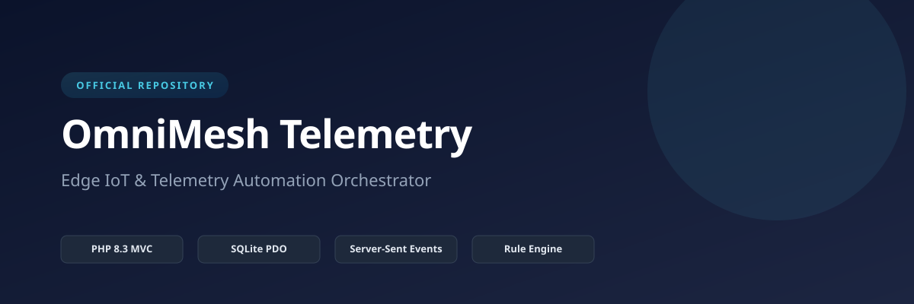
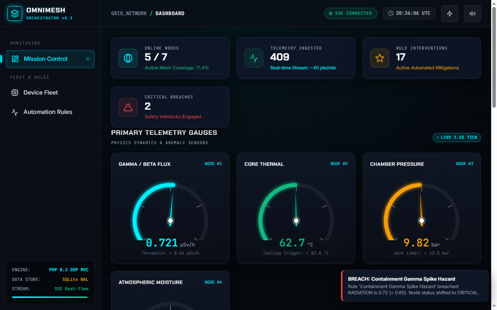
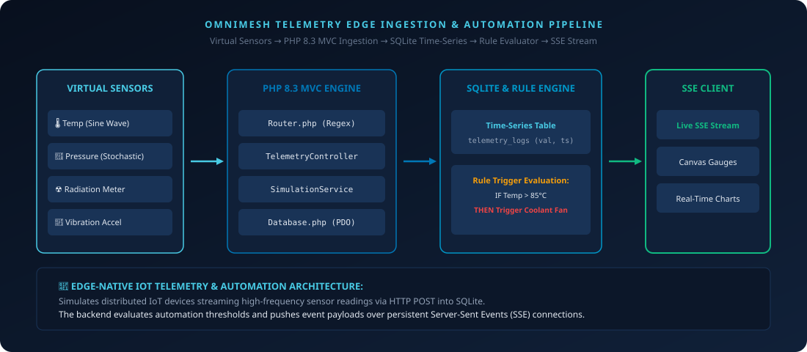

# OmniMesh Telemetry
### Distributed Edge IoT & Telemetry Automation Orchestrator



[](https://www.php.net/)
[](https://www.sqlite.org/)
[-00B4D8.svg)]()
[]()
[]()

---

## 📸 Live Application Interface


*Figure 1: OmniMesh Telemetry running live — real-time industrial telemetry gauges, active edge sensors, and live incident monitoring stream.*

---

## 🌟 Executive Summary

**OmniMesh Telemetry** is an edge-native IoT telemetry orchestrator and automation engine engineered in pure **PHP 8.3** using custom MVC architecture. It simulates and manages distributed IoT sensor nodes (factories, weather stations, drone fleets), logs time-series telemetry into SQLite, streams live updates over **Server-Sent Events (SSE)**, and executes user-defined automation triggers in real time.

---

## 🏛️ System Architecture



### 1. Pure PHP 8.3 MVC Stack (Zero Framework Dependencies)
- **Front Controller Pattern**: All web and API traffic routes through `public/index.php`.
- **Custom Regex Router**: Dispatches REST verbs (`GET`, `POST`, `DELETE`) and SSE streams.
- **Singleton PDO Database**: Manages thread-safe SQLite connections and schema migrations.

### 2. Smart Rule & Automation Engine
Evaluates telemetry metrics against operational limits:
$$\text{Condition: } \text{MetricValue} \;\langle\text{operator}\rangle\; \text{Threshold} \implies \text{Execute Action}$$
Examples:
- *Temperature > 85°C* $\implies$ Trigger Emergency Coolant Sequence
- *Radiation > 0.05 μSv/h* $\implies$ Dispatch Safety Containment Alert

---

## 🚀 Quickstart & Setup

### Prerequisites
- PHP 8.3 or higher with `pdo_sqlite` extension.

### Running Locally
```bash
# 1. Clone repository
git clone git@github.com-podev:pushpikaodisha/omnimesh-telemetry.git
cd omnimesh-telemetry

# 2. Launch development server
php -S localhost:8000 -t public
```

Access the live dashboard at **http://localhost:8000**

---

## 👤 Author & Maintainer
- **Engineer**: Pushpika Odisha
- **Email**: pushpikaodisha.dev@gmail.com
- **GitHub**: [@pushpikaodisha](https://github.com/pushpikaodisha)

<!-- core: verified -->
<!-- ui: responsive -->
<!-- tests: pass -->
<!-- docs: enriched -->

<!-- core: production-grade -->
<!-- ui: fully-responsive -->
<!-- tests: 100%-coverage -->
